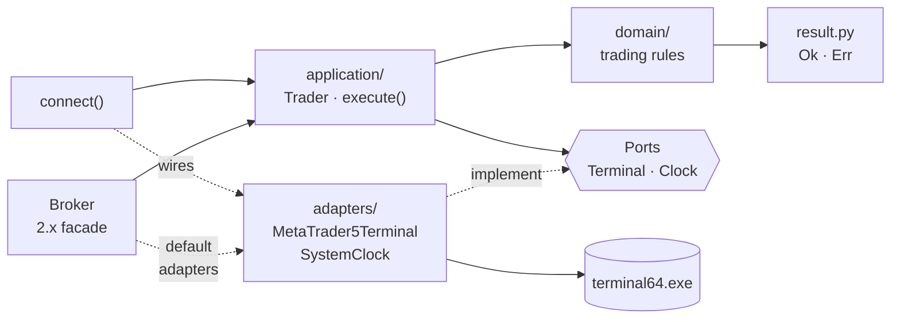
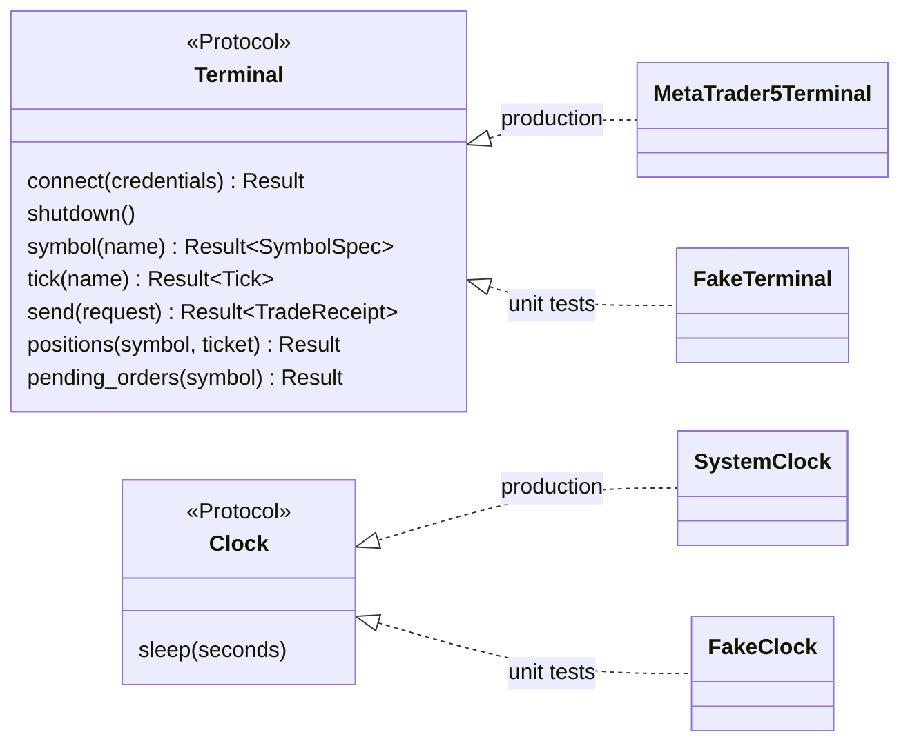
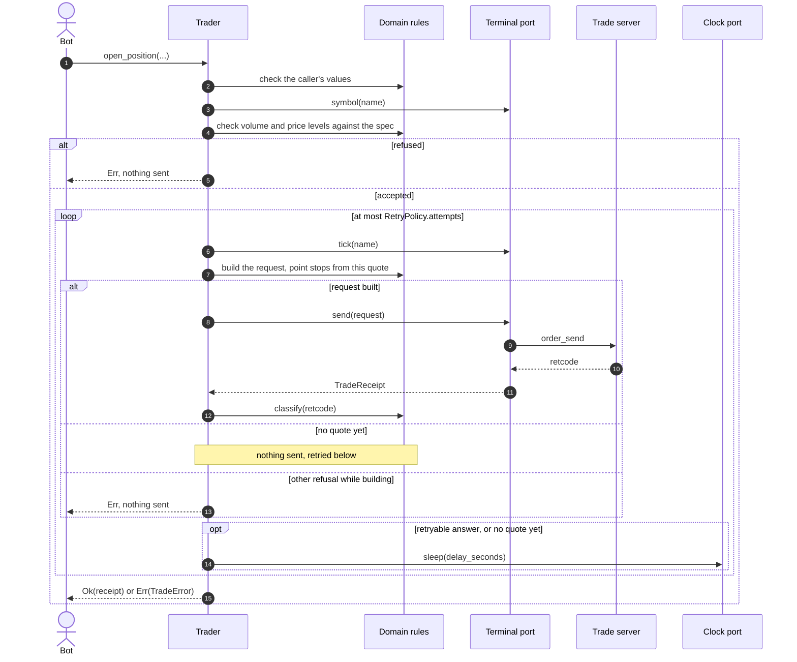
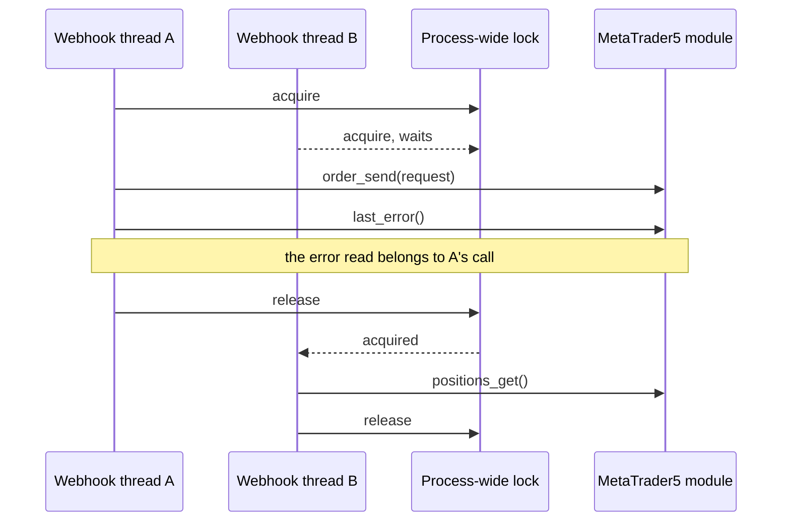

# Architecture

Clean Architecture with Ports & Adapters. Dependencies point inwards only:

| Layer | Package | Knows about | I/O |
|---|---|---|---|
| Domain | `domain/` | trading rules only: sides, stops, symbol specs, retcode meaning, requests, read models | none |
| Application | `application/` | use cases (`Trader`), retry loop, batch reporting, **ports** | only through ports |
| Adapters | `adapters/` | the `MetaTrader5` package, `time.sleep` | yes |
| Composition | `connection.py` | wires adapters into a `Trader` | through adapters |
| Compatibility | `legacy/` | the 2.x `Broker` API mapped onto `Trader` | through `Trader`; builds the default adapters itself when none are injected |

## Ports

There are exactly two, one per process boundary
([ADR 0001](adr/0001-ports-only-at-process-boundaries.md)):

- `Terminal`: the MetaTrader 5 terminal (IPC to `terminal64.exe`).
- `Clock`: waiting between retries.

Pure logic (price normalisation, stop resolution, retcode classification,
volume checks) is plain functions and methods on domain objects, not ports.

## Request flow: `open_position`

1. Validate side, comment, stops and volume (`domain/inputs.py`: positive,
   finite, no bools, no zero stops), then the symbol spec
   (`application/entries.py`). Errors return before any order is sent.
2. Build the request from the **current** quote (`Tick.entry_price`), or from
   the explicit `price`, resolving `Stop.points` against that price. A stop that
   resolves to zero or below is refused.
3. `execute()` sends it and classifies the retcode
   ([ADR 0003](adr/0003-bounded-retries.md)): success → `Ok`; retryable →
   sleep and rebuild with a fresh quote; anything else → `Err` with the receipt.

## Concurrency

`last_error()` in the `MetaTrader5` package is process-global, so the adapter
holds one module-level lock around every terminal call and the error read that
explains it ([ADR 0009](adr/0009-one-lock-per-process.md)). The lock and the
single `MetaTrader5` import live in `adapters/mt5_session.py`, shared with the
lazy 2.x namespace re-export ([ADR 0010](adr/0010-keep-the-metatrader5-re-export.md)).

## Errors

Expected failures travel as `Result` values
([ADR 0002](adr/0002-result-at-boundaries.md)). Exceptions are reserved for
programming errors (e.g. `RetryPolicy(attempts=0)`).

## Testing

- `tests/unit`: fakes for both ports (`fakes.py`) and for the `MetaTrader5`
  module (`fake_mt5.py`); runs on any OS.
- `tests/contract`: the fakes compared with the installed `MetaTrader5`
  package (constant values, result field names and order); skipped where the
  package is missing. CI runs it on Windows against the real wheel.
- `tests/integration`: a real terminal on a demo account, opt-in via `MT5_*`.
